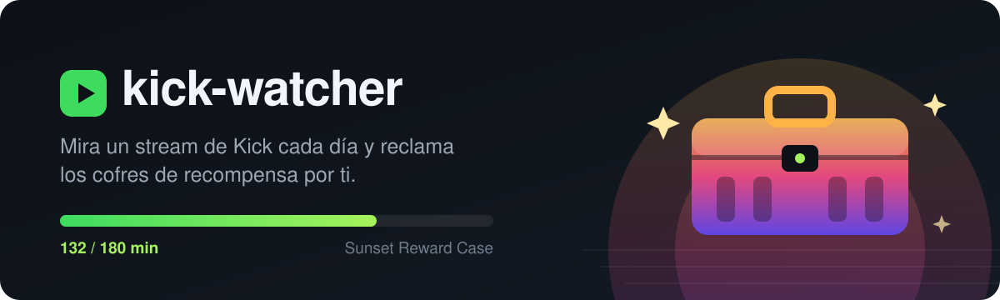
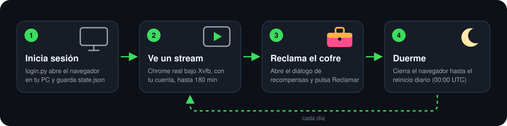

<p align="center">
  
</p>

<p align="center"><a href="README.md">Español</a> · <b>English</b></p>

# kick-watcher

**kick-watcher** is a bot for [Kick](https://kick.com) that keeps a live stream playing in a real Chrome, signed in with your own account, until the watch time required by Kick's **reward cases** (*Drops & Rewards*) is reached. It then **claims the case automatically** and sleeps until the daily reset.

It works for the **Sunset Reward Case** (watch 3 hours a day for a chance at a copy of **GTA VI**) and the 60-minute *Daily Reward*, without leaving your PC on: it runs on a headless Linux server (VPS, AWS EC2…) or on your own Windows machine.

## Features

- **Real watch time**: plays the video in Google Chrome instead of faking requests.
- **Official progress**: reads accumulated minutes from Kick's own API.
- **Auto-claim** as soon as a case unlocks.
- **Self-healing**: switches to another live stream if the current one ends or stalls.
- **Lightweight**: closes the browser when done (~700 MB RAM only while watching).
- **`status.json`** you can wire into Telegram, Discord or anything else.
- **One-command installers** for Linux (`install.sh`) and Windows (`install.ps1`).

## How it works

<p align="center">
  
</p>

## Quick start

**1. On your PC (Windows): log in**

```powershell
git clone https://github.com/josemsalcedoq/kick-watcher
cd kick-watcher
powershell -ExecutionPolicy Bypass -File .\install.ps1 -Login
```

**2a. On a Linux server (recommended)** — Amazon Linux, Fedora, RHEL, Debian or Ubuntu, x86_64:

```sh
scp state.json server:/tmp/state.json
ssh server 'curl -fsSL https://raw.githubusercontent.com/josemsalcedoq/kick-watcher/main/install.sh | sudo bash'
```

**2b. Or on the same Windows PC**

```powershell
.\install.ps1 -Autostart
```

## Usage

```sh
journalctl -u kick-watcher -f             # log
cat /var/lib/kick-watcher/status.json     # today's progress
```

Environment variables: `DATA_DIR` (profile, session, status) and `KICK_BROWSER` (`chrome` or `msedge`).

## Security

`state.json` and `login-profile/` hold your Kick session. Treat them like a password; they are git-ignored.

## Disclaimer

Unofficial project, not affiliated with Kick. Use it only with your own account: Kick may disqualify entries at its discretion under its [Drops terms](https://kick.com/kick-drops-terms), and opening a case gives a chance of a prize, not a guaranteed one. One person, one account — multi-account farming is out of scope. Use at your own risk.

## License

[MIT](LICENSE)
