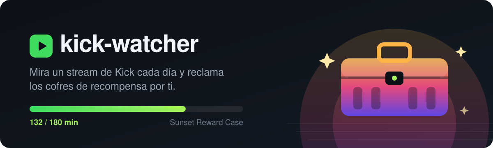
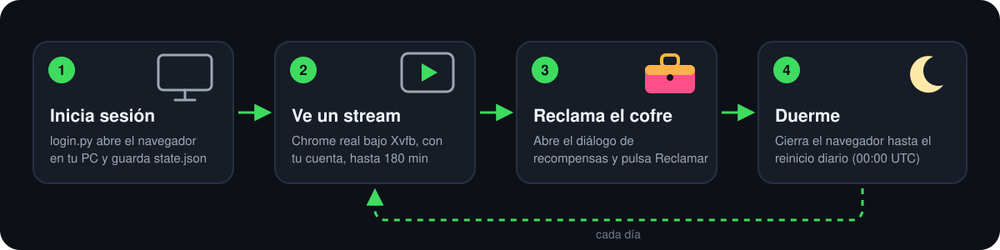

<p align="center">
  
</p>

<p align="center">
  <a href="LICENSE"></a>
  
  
  
</p>

<p align="center"><b>Español</b> · <a href="README.en.md">English</a></p>

# kick-watcher

**kick-watcher** es un bot para [Kick](https://kick.com) que mantiene un stream reproduciéndose en un Chrome real, con tu propia cuenta, hasta completar el tiempo de visualización que piden los **cofres de recompensa** (*Kick Drops & Rewards*), los **reclama solo** y duerme hasta el reinicio diario.

Sirve, por ejemplo, para el **Sunset Reward Case** (ver 3 horas de stream al día para optar a una copia de **GTA VI**) y para el *Daily Reward* de 60 minutos, sin tener que dejar el PC encendido: corre en un servidor Linux sin pantalla (VPS, AWS EC2…) o en tu propio Windows.

## Características

- **Tiempo de visualización real**: reproduce el video en Google Chrome (no simula peticiones), así que Kick lo cuenta como cualquier pestaña abierta.
- **Progreso oficial**: lee los minutos acumulados de la propia API de Kick, no los estima.
- **Reclamo automático** del cofre en cuanto se desbloquea.
- **Se recupera solo**: si el stream termina o se congela, cambia a otro en vivo.
- **Ligero**: cierra el navegador al terminar y duerme hasta el día siguiente (~700 MB de RAM solo mientras ve).
- **`status.json`** con el estado del día, fácil de conectar a Telegram, Discord o lo que uses.
- **Instalador de un comando** para Linux (`install.sh`) y Windows (`install.ps1`).

## Cómo funciona

<p align="center">
  
</p>

1. `login.py` abre una ventana del navegador en tu PC; inicias sesión en Kick a mano y la sesión queda en `state.json`.
2. `watcher.py` importa esa sesión, elige un stream en vivo con muchos espectadores (salta casino y contenido +18) y comprueba cada minuto que el video avance.
3. Consulta `web.kick.com/api/v1/gamification/challenges`; cuando un cofre llega a su meta, abre el diálogo de recompensas y pulsa **Reclamar**.
4. Duerme hasta que termine la ventana diaria (00:00 UTC) y vuelve a empezar.

## Instalación rápida

### 1. En tu PC (Windows): iniciar sesión

```powershell
git clone https://github.com/josemsalcedoq/kick-watcher
cd kick-watcher
powershell -ExecutionPolicy Bypass -File .\install.ps1 -Login
```

Instala lo necesario en `.venv`, abre el navegador y guarda `state.json` cuando inicias sesión.

### 2a. En un servidor Linux (recomendado)

Copia la sesión y ejecuta el instalador (Amazon Linux, Fedora, RHEL, Debian o Ubuntu, x86_64):

```sh
scp state.json servidor:/tmp/state.json
ssh servidor 'curl -fsSL https://raw.githubusercontent.com/josemsalcedoq/kick-watcher/main/install.sh | sudo bash'
```

Instala Google Chrome, Xvfb y Python, crea el usuario `kickwatcher`, el servicio systemd `kick-watcher` y lo arranca. Se puede volver a ejecutar para actualizar.

### 2b. O en el mismo PC con Windows

```powershell
.\install.ps1 -Autostart
```

Crea una tarea programada que arranca el watcher al iniciar sesión. La ventana del navegador queda abierta mientras ve el stream.

## Uso

| Qué | Linux | Windows |
| --- | --- | --- |
| Ver el registro | `journalctl -u kick-watcher -f` | — |
| Progreso del día | `cat /var/lib/kick-watcher/status.json` | `type %USERPROFILE%\.kick-watcher\status.json` |
| Reiniciar | `sudo systemctl restart kick-watcher` | `Start-ScheduledTask kick-watcher` |
| Desinstalar | `sudo systemctl disable --now kick-watcher` | `.\install.ps1 -Uninstall` |

Ejemplo de `status.json`:

```json
{
 "fase": "viendo",
 "viendo": "nombre_del_canal",
 "cofres": [
  {"nombre": "Daily Reward", "min": 42, "meta": 60, "estado": "in_progress"},
  {"nombre": "Sunset Reward Case", "min": 42, "meta": 180, "estado": "in_progress"}
 ]
}
```

Modos de depuración (dejan capturas en `debug/`):

```sh
watcher.py probe [canal]   # abre un stream ~40 s y comprueba que el video avanza
watcher.py inspect         # abre el diálogo de recompensas y registra las llamadas a la API
```

## Configuración

| Variable | Por defecto | Para qué |
| --- | --- | --- |
| `DATA_DIR` | `/var/lib/kick-watcher` (servidor) o `~/.kick-watcher` | Perfil del navegador, sesión, estado y capturas |
| `KICK_BROWSER` | `chrome` (`msedge` en Windows si no hay Chrome) | Canal de navegador de Playwright |

## Preguntas frecuentes

**¿Por qué Google Chrome y no el Chromium de Playwright?**
El Chromium de Playwright no incluye el códec H.264 y el reproductor de Kick no arranca.

**¿Kick cerró la sesión?**
`status.json` pasa a `"fase": "sesion_perdida"`. Repite `install.ps1 -Login`, copia el nuevo `state.json` al servidor y vuelve a ejecutar `install.sh`.

**¿Funciona desde una IP de centro de datos?**
Probado en AWS (sa-east-1): Kick carga sin captcha y los minutos cuentan.

**¿Puedo usar varias cuentas?**
No está pensado para eso ni se va a añadir: una persona, una cuenta.

## Seguridad

`state.json` y la carpeta `login-profile/` contienen tu sesión de Kick. Trátalos como una contraseña: están en `.gitignore`, no los subas ni los compartas.

## Aviso

Proyecto no oficial, sin relación con Kick. Úsalo solo con tu propia cuenta: Kick puede descalificar participaciones a su discreción según sus [términos de Drops](https://kick.com/kick-drops-terms), y abrir un cofre da una probabilidad de premio, no un premio garantizado. El riesgo de usarlo es tuyo.

## Licencia

[MIT](LICENSE)
